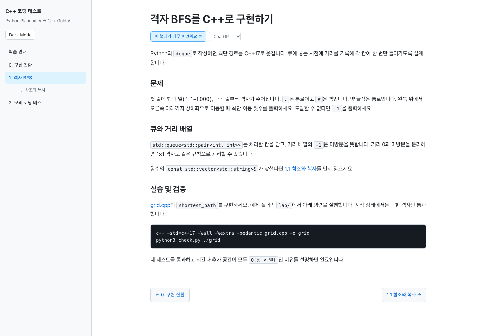
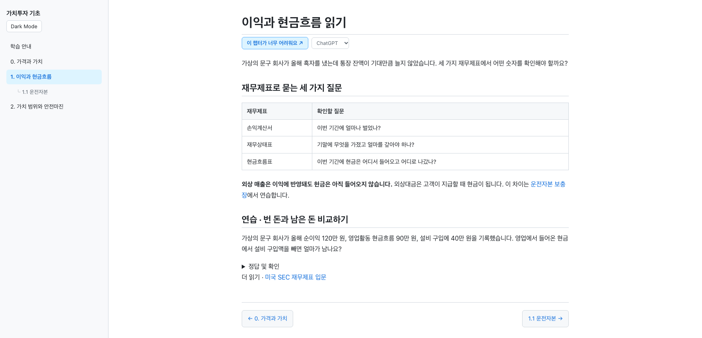
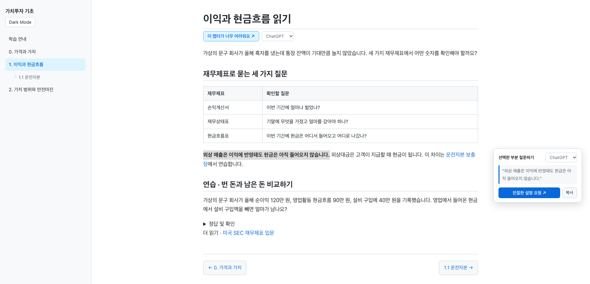

# Create HTML Textbook

[한국어](README.md) · English

> 우리보다 그들이 현명하고 노련해질 수 있다는 사실을 받아들이고 나면
> 우리가 얼마나 큰 힘을 가지고 있는지 알게된다.
>
> 우리는 우리의 스승을 만들 수있는 유일한 종이 되었다는 것을.
>
> — [반-바지. (@bahnbazi), 《둘이서 추는 춤》](https://x.com/bahnbazi/status/953307342921060352)

An Agent Skill that turns technical learning requests into offline HTML textbooks. It builds on what the learner already knows, provides practice and checks suited to the subject, and adds a linked subchapter when a concept needs more explanation.

## Install and use

Paste this request into Codex or Claude Code.

```text
Install the create-html-textbook skill from https://github.com/Uniaut/create-html-textbook.
```

Then invoke the skill with a request like this:

```text
$create-html-textbook I solve BOJ problems up to Platinum V in Python. Build an offline HTML textbook to help me prepare for coding tests in C++17, targeting Gold V. Give me starter code and tests for the exercises.
```

A follow-up that exercises the branching workflow:

```text
$create-html-textbook I’m stuck on const T& in the grid BFS chapter. Add a follow-up chapter that explains references and copies.
```

## What you can study

- **Coding** · Port familiar algorithms to another language and check your implementation with starter code and tests.
- **Economics and finance** · Read financial statements for a fictional business and calculate how valuation assumptions affect the result.
- **Languages** · Practice expressions in level-appropriate dialogues and revisit confusing grammar in follow-up lessons.

## Example · Python to C++ for coding tests

The Korean sample assumes Python experience through BOJ Platinum V and targets implementation practice through Gold V in C++17. Start at [the curriculum](examples/python-to-cpp/docs/index.html), try the [grid BFS lab](examples/python-to-cpp/docs/lessons/ch1-grid-bfs.html), and follow the [const reference subchapter](examples/python-to-cpp/docs/lessons/ch1-1-const-reference.html).



Clone the repository and open the example’s `docs/index.html` directly in a browser. The example includes a C++17 skeleton and a Python 3 test runner. The starter intentionally fails cases that require a path.

## Example · Value investing basics

This Korean textbook introduces price and value, profit and cash flow, and the margin of safety. Work through fictional examples and reveal each answer when you are ready. [Open the value investing curriculum](examples/value-investing/docs/index.html)

## Full-text search

Type keywords into the search box below the theme button and press Enter to list every chapter that matches. Spaces separate keywords, and `/` focuses the box from anywhere. Opening a result highlights the keywords in that chapter and jumps to the first occurrence of the first keyword. Use the ‹ › buttons or Enter in the bar at the bottom to step through matches, and Esc to clear them.

To work offline from `file://`, the text is prebuilt into `assets/search-index.js`. After editing or adding chapters, rebuild it with `python3 scripts/build_search_index.py <docs path>`. Try it on the example's [search page](examples/value-investing/docs/search.html).

## Ask ChatGPT while reading

### Ask about a whole chapter

Click **이 챕터가 너무 어려워요 ↗** (This chapter is too hard) beneath the chapter title. The helper uses the chapter title and section headings to build a question and opens ChatGPT in a new tab.



### Ask about selected text

Select a passage to reveal the help widget. Click **친절한 설명 요청 ↗** (Ask for an explanation) to open ChatGPT with the selection and nearby context, or click **복사** (Copy) to copy the question.



ChatGPT is the default. The provider menu also offers Claude and Perplexity. Reading and navigation work offline. Opening an AI provider requires internet access.

## Repository layout

| Path | Purpose |
| --- | --- |
| [SKILL.md](SKILL.md) | Skill discovery metadata and the creation, branching, and verification workflows |
| [assets/](assets/) | CSS and JavaScript copied into generated textbooks |
| [scripts/](scripts/) | Python 3 local-link checker and search index builder |
| [examples/python-to-cpp/](examples/python-to-cpp/) | Sample textbook, exercise, and screenshot |
| [examples/value-investing/](examples/value-investing/) | Value investing textbook and AI help screenshots |

The directory and frontmatter follow the [Agent Skills specification](https://agentskills.io/specification). The root README provides installation and examples for readers, while the skill instructions are kept in SKILL.md.

## Verify the example

```sh
python3 scripts/verify_links.py examples/python-to-cpp/docs
python3 scripts/verify_links.py examples/value-investing/docs
python3 scripts/build_search_index.py examples/python-to-cpp/docs
python3 scripts/build_search_index.py examples/value-investing/docs
```
