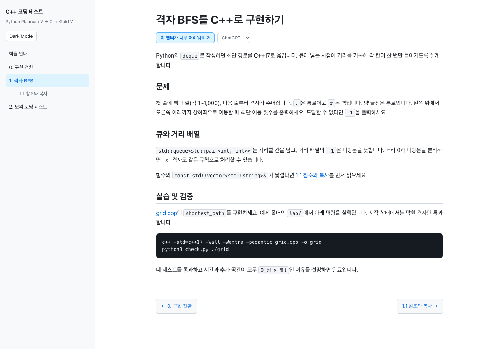

# Adaptive HTML Study

An Agent Skill that turns technical learning requests into offline HTML textbooks. It builds on what the learner already knows, gives them code skeletons and runnable checks, and adds a linked subchapter when a specific prerequisite needs more explanation.

이미 아는 내용은 건너뛰고, 막힌 개념은 기존 교과서의 보충 장으로 추가하는 HTML 교과서 제작 스킬입니다.

## Example · Python to C++ for coding tests

The Korean sample assumes Python experience through BOJ Platinum V and targets implementation practice through Gold V in C++17. Start at [the curriculum](examples/python-to-cpp/docs/index.html), try the [grid BFS lab](examples/python-to-cpp/docs/lessons/ch1-grid-bfs.html), and follow the [const reference subchapter](examples/python-to-cpp/docs/lessons/ch1-1-const-reference.html).



Clone the repository and open the example’s `docs/index.html` directly in a browser. The example includes a C++17 skeleton and a Python 3 test runner. The starter intentionally fails cases that require a path.

## Install and use

From the root of a project that uses Codex:

```sh
mkdir -p .agents/skills
git clone https://github.com/Uniaut/adaptive-html-study.git .agents/skills/adaptive-html-study
```

Then invoke the skill with a request like this:

> $adaptive-html-study Python으로 BOJ 플래티넘 V까지 풀어 봤어. C++17로 코딩 테스트를 준비할 수 있게 골드 V까지 목표로 하는 오프라인 HTML 교과서를 만들어 줘. 실습은 뼈대와 테스트만 제공해 줘.

A follow-up that exercises the branching workflow:

> $adaptive-html-study 격자 BFS 장에서 const T&가 왜 필요한지 모르겠어. 참조와 복사를 비교하는 보충 장을 추가해 줘.

Reading and navigation work offline. Opening an AI provider requires a connection and sends the chapter topics or selected text and nearby context to the chosen provider.

## Repository layout

| Path | Purpose |
| --- | --- |
| [SKILL.md](SKILL.md) | Skill discovery metadata and the creation, branching, and verification workflows |
| [assets/](assets/) | CSS and JavaScript copied into generated textbooks |
| [scripts/](scripts/) | Python 3 local-link checker |
| [examples/python-to-cpp/](examples/python-to-cpp/) | Sample textbook, exercise, and screenshot |

The directory and frontmatter follow the [Agent Skills specification](https://agentskills.io/specification). The root README provides installation and examples for readers, while the skill instructions are kept in SKILL.md.

## Verify the example

```sh
python3 scripts/verify_links.py examples/python-to-cpp/docs
```
