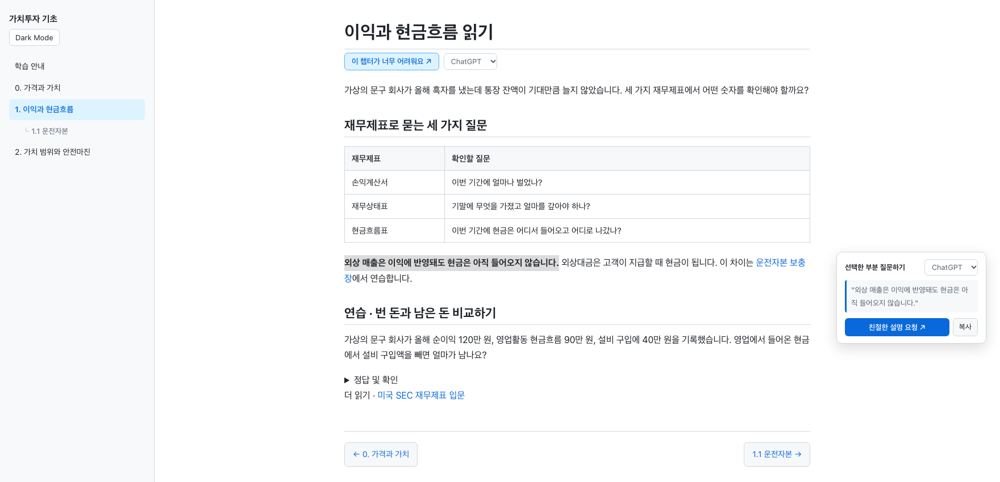

# Create HTML Textbook

한국어 · [English](README.en.md)

> 우리보다 그들이 현명하고 노련해질 수 있다는 사실을 받아들이고 나면
> 우리가 얼마나 큰 힘을 가지고 있는지 알게된다.
>
> 우리는 우리의 스승을 만들 수있는 유일한 종이 되었다는 것을.
>
> — [반-바지., 《둘이서 추는 춤》](https://x.com/bahnbazi/status/953307342921060352)

학습자의 배경에 맞춰 오프라인 HTML 교과서를 만들고, 막히는 개념을 보충 장으로 추가하는 에이전트 스킬입니다. 이미 아는 내용은 건너뛰고, 분야에 맞는 실습과 확인 문제를 제공합니다.

## 설치와 사용

Codex나 Claude Code에 아래 요청을 붙여 넣으세요.

```text
https://github.com/Uniaut/create-html-textbook 저장소의 create-html-textbook 스킬을 설치해줘.
```

교과서를 처음 만들 때는 현재 수준과 목표를 알려주세요.

```text
$create-html-textbook Python으로 백준 플래티넘 V까지 풀어 봤어. C++17로 골드 V 수준의 코딩 테스트를 준비할 수 있게 오프라인 HTML 교과서를 만들어 줘. 실습은 코드 뼈대와 테스트로 구성해 줘.
```

읽다가 막히면 어느 장의 어떤 개념인지 알려주세요.

```text
$create-html-textbook 격자 BFS 장에서 const T&가 왜 필요한지 모르겠어. 참조와 복사를 비교하는 보충 장을 추가해 줘.
```

## 활용 분야

- **코딩** · 알고리즘을 다른 언어로 구현하고, 코드 뼈대와 테스트로 검증합니다.
- **경제·금융** · 가상의 기업 사례로 재무제표를 읽고, 가치평가 가정에 따라 결과가 어떻게 달라지는지 계산합니다.
- **외국어** · 학습자의 수준에 맞춘 대화문으로 표현을 연습하고, 헷갈리는 문법을 보충 장에서 비교합니다.

## 예제 · Python에서 C++ 코딩 테스트로

Python으로 백준 플래티넘 V까지 풀어 본 학습자가 C++17로 골드 V 수준의 문제를 풀 수 있도록 구성한 예제입니다. [학습 안내](examples/python-to-cpp/docs/index.html)에서 시작해 [격자 BFS 실습](examples/python-to-cpp/docs/lessons/ch1-grid-bfs.html)을 해보고, `const T&`가 낯설다면 [참조와 복사 보충 장](examples/python-to-cpp/docs/lessons/ch1-1-const-reference.html)으로 이어서 읽을 수 있습니다.


저장소를 내려받은 뒤 `examples/python-to-cpp/docs/index.html`을 브라우저에서 열면 됩니다. C++17 코드 뼈대와 Python 3 테스트 실행기가 포함되어 있습니다. 경로가 있는 입력은 BFS를 구현해야 테스트를 통과합니다.

## 예제 · 가치투자 기초

재무제표가 낯선 독자를 위해 가격과 가치, 이익과 현금흐름, 안전마진을 설명합니다. 가상의 문구 회사 사례를 계산하고 각 장에서 접힌 답안을 열어 확인할 수 있습니다. [가치투자 기초 학습 안내](examples/value-investing/docs/index.html)

## 전체 검색

사이드바 테마 버튼 아래 검색창에 키워드를 입력하고 Enter를 누르면, 모든 장에서 일치하는 곳을 찾아 목록으로 보여 줍니다. 키워드는 공백으로 나누고, 어디서든 `/`를 누르면 검색창으로 이동합니다. 결과를 열면 해당 장에서 키워드가 하이라이트되고, 첫 키워드가 처음 나오는 곳으로 바로 이동합니다. 화면 아래 막대의 ‹ › 버튼이나 Enter로 다음 일치로 넘어가고, Esc로 하이라이트를 지웁니다.

오프라인(`file://`)에서도 동작하도록 본문을 `assets/search-index.js`에 미리 담아 둡니다. 장을 고치거나 추가했다면 `python3 scripts/build_search_index.py <docs 경로>`로 다시 만드세요. 직접 써 보려면 예제의 [검색 페이지](examples/value-investing/docs/search.html)를 여세요.

## 읽다가 막혔을 때 ChatGPT에 질문하기

### 챕터 전체 질문하기

장 제목 아래 **이 챕터가 너무 어려워요 ↗**를 누르면 장 제목과 절 제목을 넣은 질문을 만들고 ChatGPT를 새 탭에서 엽니다.


### 선택한 문장 질문하기

본문에서 궁금한 문장을 드래그하면 **선택한 부분 질문하기**가 나타납니다. **친절한 설명 요청 ↗**을 누르면 선택한 텍스트와 주변 문맥을 담아 ChatGPT를 열고, **복사**를 누르면 질문만 복사합니다.



기본 서비스는 ChatGPT이며, 드롭다운에서 Claude나 Perplexity로 바꿀 수 있습니다. 본문과 목차는 오프라인에서도 열리고, AI 서비스를 이용하려면 인터넷 연결이 필요합니다.

## 저장소 구조

| 경로 | 역할 |
| --- | --- |
| [SKILL.md](SKILL.md) | 스킬 검색용 메타데이터와 교과서 작성·보충·검증 절차 |
| [assets/](assets/) | 교과서에 복사할 CSS와 JavaScript |
| [scripts/](scripts/) | Python 3 로컬 링크 검사기와 검색 인덱스 생성기 |
| [examples/python-to-cpp/](examples/python-to-cpp/) | 예제 교과서, 실습 코드, 스크린샷 |
| [examples/value-investing/](examples/value-investing/) | 가치투자 입문 교과서와 AI 도움말 스크린샷 |

스킬 폴더와 `SKILL.md`의 메타데이터는 [Agent Skills 공식 명세](https://agentskills.io/specification)를 따릅니다.

## 예제 검증

```sh
python3 scripts/verify_links.py examples/python-to-cpp/docs
python3 scripts/verify_links.py examples/value-investing/docs
python3 scripts/build_search_index.py examples/python-to-cpp/docs
python3 scripts/build_search_index.py examples/value-investing/docs
```
